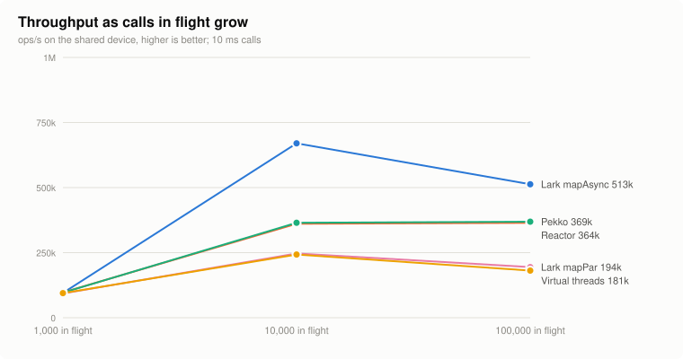
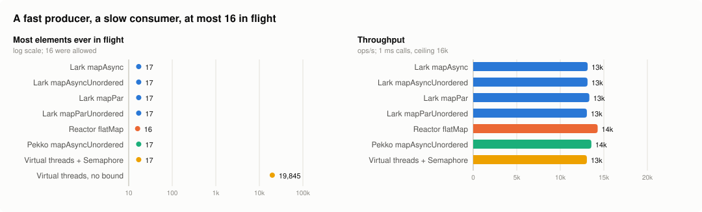
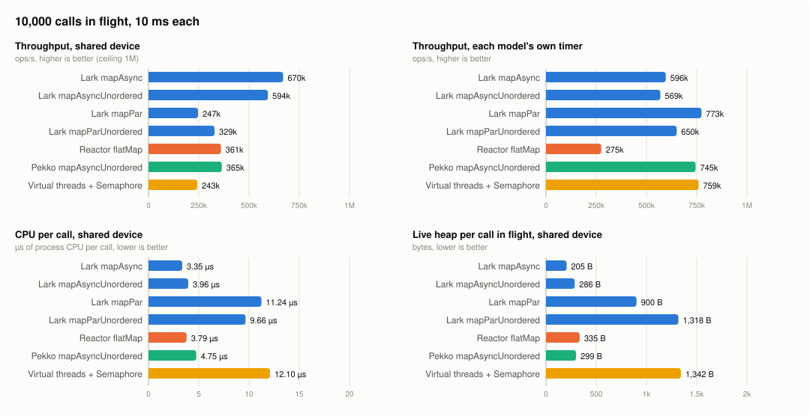
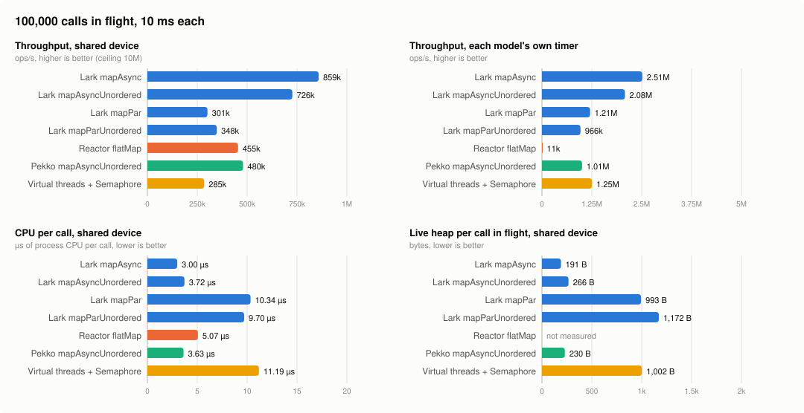
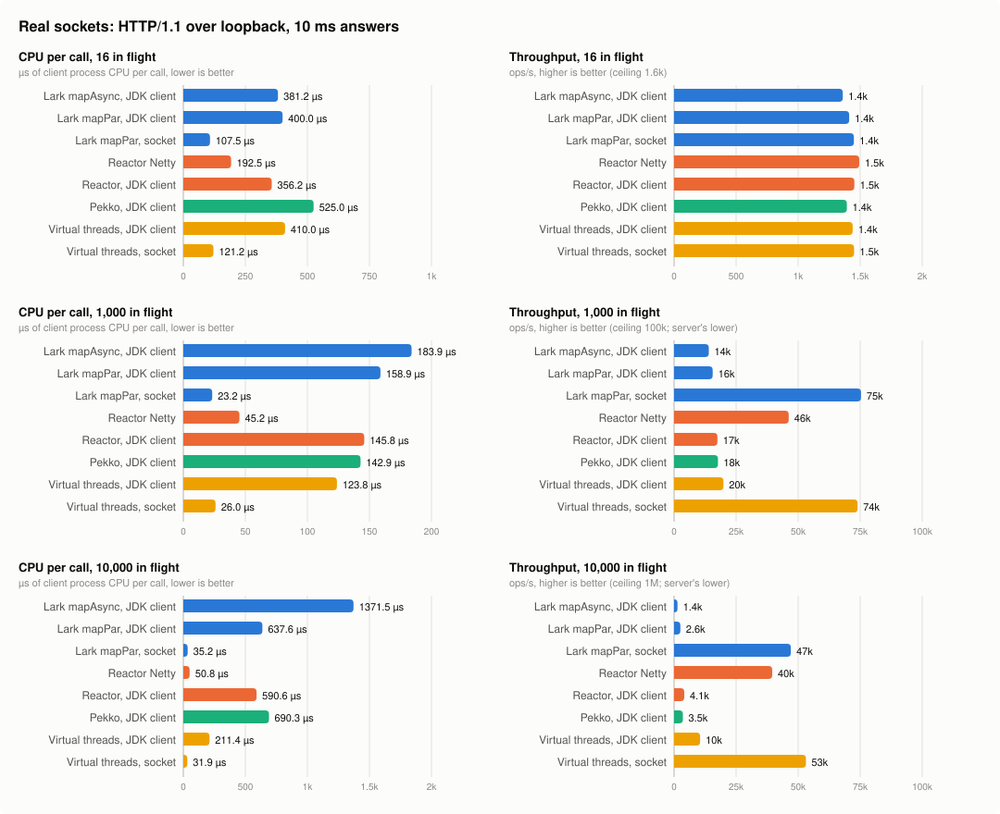
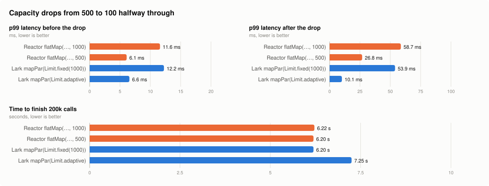
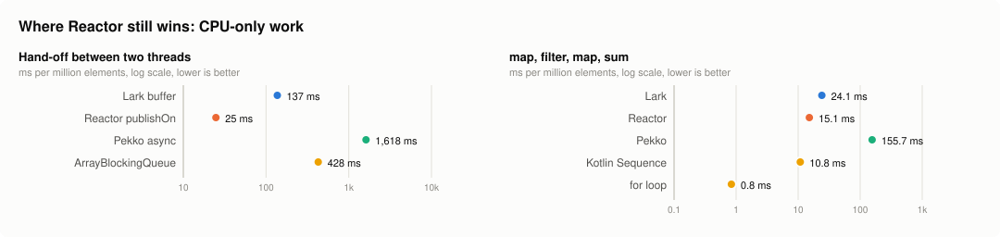
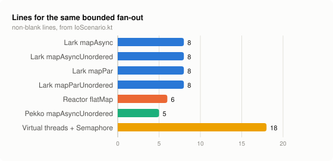

# Blocking vs reactive

Do virtual threads make reactive programming unnecessary? This repo puts blocking code on virtual threads (plain JDK,
and [Lark](https://github.com/matthewjones372/lark)'s `lark-stream`) against Project Reactor and Pekko Streams, on
workloads chosen to favour the reactive side.

The author prefers the blocking side. So the predictions were written down and committed in
[`HYPOTHESES.md`](HYPOTHESES.md) before anything was measured, and every result is reported, losses included.

## In short

- **Backpressure is as easy with virtual threads as with Reactor, but you still have to bound the work.** Every
  bounded contestant held 16–17 elements in flight; the unbounded virtual-thread version let 19,997 pile up.
- **At 1,000 calls in flight, every model ties:** 93–97k ops/s against a ceiling of 100k.
- **From 10,000 calls in flight up, Lark's `mapAsync` beats Reactor.** It does 1.4–1.9× Reactor's throughput, at
  less CPU per call, with 60% of the heap per pending call.
- **On real sockets, blocking code is no more expensive than Reactor Netty.** Virtual threads blocked in a plain
  `Socket` used 0.5–0.7× Reactor Netty's CPU per call. The 2.5–4× gap on the shared device comes from how
  its virtual threads are woken (by a platform thread), not from blocking itself. The same gap reappears on the JDK's
  `HttpClient`, which wakes them the same way, and Reactor pays it too on that client.
- **Lark's adaptive `Limit` protects a dependency that loses capacity.** p99 after the drop is 11 ms, against 26 ms
  for Reactor at its best fixed concurrency. It costs 7% of throughput.
- **Reactor still wins on CPU-only work.** It hands elements between threads 1.5× faster than Lark, and runs a
  CPU-only operator chain 1.2× faster.
- **As a server, blocking code beats hand-written Jetty, and blocking code on io_uring beats both.** A
  virtual-thread-per-connection server did 1.9× hand-written Jetty's requests a second on HttpArena's `baseline`,
  10× pipelined and 1.7× on a 10 KB JSON body, on two cores. The same handler on an io_uring runtime of its own, still
  written as blocking code, did a further 1.5×, 1.4× and 1.3× ([Servers](#servers)).

## Throughput as concurrency grows



All four models tie at 1,000 calls in flight, where the 100k ops/s ceiling is the limit. From 10,000 calls in flight
up, Lark's `mapAsync` pulls away. The models that park a thread per call (`mapPar`, plain virtual threads) fall
behind Reactor and Pekko.

## The tests

Each I/O test sends elements from a source as fast as it can make them, through one 10 ms I/O call each, with at most
*N* calls in flight, and sums the answers. Each contestant's code is in
[`IoScenario.kt`](src/main/kotlin/bvr/IoScenario.kt) between `region` markers.

| contestant | what it is |
|---|---|
| Lark `mapAsync` | `mapAsync(n) { asyncCall(it) }`: composes a `CompletionStage` and parks no thread per call |
| Lark `mapAsyncUnordered` | the same, passing answers on in completion order |
| Lark `mapPar` | `mapPar(n) { blockingCall(it) }`: one virtual thread per call in flight |
| Lark `mapParUnordered` | the same, in completion order |
| Reactor `flatMap` | `Flux.flatMap({ Mono.fromFuture(asyncCall(it)) }, n)` |
| Pekko `mapAsyncUnordered` | `Source.mapAsyncUnordered(n) { asyncCall(it) }` |
| Virtual threads + `Semaphore` | plain JDK: a `Semaphore(n)` and one virtual thread per call |

There are two I/O devices, because the device changes the result:

- **Shared device.** Every contestant calls the same fake client: a `CompletableFuture` completed by a two-thread
  timer, as a socket poller or a Netty event loop would complete it. The async contestants compose the future; the
  blocking ones `join()` it. This is the fairer comparison, and the one the headline numbers use.
- **Each model's own timer.** Virtual threads `Thread.sleep`, Reactor uses `Mono.delay` on its parallel scheduler,
  and Lark's `mapAsync` uses a JDK `ScheduledThreadPoolExecutor` with a thread per core, as Reactor's scheduler has.
  Pekko uses its own scheduler, which ticks every millisecond: on its own that caps 16 calls in flight at about
  4,900 ops/s, so Pekko's low-concurrency rows here measure the tick.

[`Harness.kt`](src/main/kotlin/bvr/Harness.kt) measures:
- throughput, process CPU and allocation;
- the most elements ever outstanding, sampled every millisecond;
- live heap per pending call, from a full GC taken mid-run once at least 90% of the target concurrency is reached.

Medians over 2 JVM forks × 4 measured iterations, after 2 warm-up iterations. Every number is in
[`results/summary.md`](results/summary.md).

### Backpressure



There's a fast producer and a slow consumer (1 ms calls), with at most 16 in flight. Every bounded contestant held
16–17 elements in flight, at the same throughput. The virtual-thread version with no bound held 19,997. Virtual
threads don't give you backpressure for free, but a `Semaphore` or a bounded window is all it takes.

### 1,000 calls in flight


Every model reaches 93–97k ops/s against a ceiling of 100k. At typical service concurrency, throughput is no reason
to choose a model. Lark's `mapAsync` uses the least CPU per call and the least heap per pending call.

### 10,000 calls in flight



- **Shared device.** Lark's `mapAsync` does 670k ops/s against Reactor's 361k, at less CPU per call (3.35 against
  3.79 µs). It holds 205 B per pending call against Reactor's 335 B.
- **Blocking bodies.** `mapPar` (247k ops/s, 11.2 µs per call) and plain virtual threads trail Reactor here, and hold
  0.7–1.2 KB per pending call.
- **Own timers.** Blocking bodies win: `mapPar` does 773k ops/s and plain virtual threads 759k, against Reactor's
  275k.

### 100,000 calls in flight



- **Shared device.** Lark's `mapAsync` does 513k ops/s against Reactor's 364k and Pekko's 369k. Pekko uses the least
  CPU per call (4.67 µs, against Lark's 4.87 and Reactor's 5.88). Lark peaks at 626 MB RSS, against Pekko's 1,007 MB
  and Reactor's 2,625 MB.
- **Reactor's heap.** Reactor never reached 90% of its 100,000-call target, so its live heap per call couldn't be
  measured.
- **Own timers.** Reactor's `flatMap` over `Mono.delay` collapsed to 10k ops/s, against about 1M for the others. Thread dumps show the whole pipeline
  on one `parallel` worker inside `FluxFlatMap.drainLoop`, so treat that bar as Reactor at an extreme, not Reactor in
  general.

### Real sockets



Each call is an HTTP/1.1 `GET` over loopback, with keep-alive, to a server in its own JVM (Netty, one event-loop
thread pinned to its own core) that answers after 10 ms. The client gets the other 3 cores. Code:
[`NetScenario.kt`](src/main/kotlin/bvr/NetScenario.kt), [`NetServer.kt`](src/main/kotlin/bvr/NetServer.kt).

CPU per call, µs:

| contestant | 16 | 1k | 10k |
|---|--:|--:|--:|
| Virtual threads over a plain `Socket` | 121 | 26.0 | 31.9 |
| Lark `mapPar` over a plain `Socket` | 108 | 23.3 | 35.2 |
| Reactor Netty `HttpClient` | 193 | 45.3 | 50.8 |
| Virtual threads on the JDK `HttpClient` | 410 | 124 | 211 |
| Lark `mapPar` on the JDK `HttpClient` | 400 | 159 | 638 |
| Lark `mapAsync` on the JDK `HttpClient` | 381 | 184 | 1,372 |
| Reactor on the JDK `HttpClient` | 356 | 146 | 591 |
| Pekko on the JDK `HttpClient` | 525 | 143 | 690 |

- **Blocking sockets.** A virtual thread blocked in a socket read is woken by the JDK's own poller. The same
  `Semaphore` loop and the same `mapPar` used 0.5–0.7× Reactor Netty's CPU per call, and a quarter of its allocation.
  The socket client is about 40 lines written for this test, and does less than Reactor Netty's full HTTP codec, so
  read this as "blocking sockets are not more expensive", not as a margin to bank. At 1k and 10k both socket
  contestants hit the one-core server's ceiling of about 70k calls a second.
- **The JDK `HttpClient`.** It is asynchronous inside: `send` is `sendAsync(...).get()`, so a virtual thread in `send`
  is woken by a platform thread, as on the shared device. Everything on it costs 1.9–3.5× Reactor Netty's CPU at 16
  and 1k, Reactor included. At 10k connections it collapses for everyone (1.4–10.5k ops/s): its pool walks a list of
  every idle connection under one lock, and its default executor grew to about 8,800 platform threads.
- **Scheduler settings** ([chart](docs/charts/net-scheduler.svg)). JDK 25 accepts `-Djdk.pollerMode=1` (platform
  poller threads) and `2` (virtual-thread pollers, Linux's default). No setting moved CPU per call by
  more than the gap between two runs of the same default configuration (up to 40% in the latest run), so none is worth
  changing from the default.

### A dependency that loses capacity



The dependency serves 500 calls at once, 5 ms each. After 100,000 of the 200,000 calls, its capacity drops to 100, as
if a replica failed. Latency is measured per call, including the dependency's own queue, which is what a caller's
timeout sees.

- **Fixed concurrency.** Every fixed setting sees its p99 grow 4–5× when capacity drops: 52 ms at 1,000, and
  26 ms even at the best fixed number.
- **The adaptive limit.** `mapPar(Limit.adaptive(…))` follows the capacity down without overshooting, and holds p99
  at 11 ms.
- **The cost.** It finishes 7% later. Pinning a limit at the dependency's real capacity (500–600) costs the same: only a
  limit near 1,000 hides the gap between one call finishing and the next starting, and that queue is what gives fixed
  concurrency its p99.
- **Reactor.** It has nothing built in that adapts. Netflix's `concurrency-limits` library would close the gap.

### CPU-only work and hand-offs



These are JMH runs, measured in ms per million elements.
- **Hand-off between threads.** Reactor's `publishOn` takes 30 ms and Lark's `buffer` 45 ms, a sixth of what a plain
  `ArrayBlockingQueue` between virtual threads takes (283 ms). Reactor's number barely crosses threads: after the
  first batch, 99.96% of its elements are emitted on the consumer's own thread, because `publishOn` requests more from
  its drain loop and `range` emits on whichever thread asks. Lark's `buffer` runs upstream on a thread of its own.
- **CPU-only chain.** For map, filter, map and sum, Reactor takes 15.9 ms and Lark 19.5 ms (1.2×), but Lark
  allocates 56 MB per million elements to Reactor's 12, boxing between steps that the JIT removes for Reactor. A plain
  loop beats everything.

### Code and stack traces



The stream DSLs are short; plain virtual threads with a `Semaphore` take 18 lines.

Where blocking code wins clearly is the stack trace when a call fails
([`results/stacktraces.txt`](results/stacktraces.txt)):

| contestant | names the handler | names the failing fetch |
|---|---|---|
| Virtual threads + `Semaphore` | yes | yes |
| Lark | yes | yes |
| Reactor | only through `block()`, which a WebFlux handler never calls | no |
| Pekko | yes | no |

## Servers

How fast can a server written as blocking code serve HTTP? This round was pre-registered separately, in
[`HYPOTHESES-SERVERS.md`](HYPOTHESES-SERVERS.md).

| contestant | what it is |
|---|---|
| `vt-arena` | [`VtArena.kt`](src/main/kotlin/bvr/arena/VtArena.kt): a `ServerSocket`, one virtual thread per connection, blocking reads, a parser over the read buffer that allocates no strings, and every pipelined request already read answered with one write |
| `jetty-arena` | [`JettyArena.kt`](src/main/kotlin/bvr/arena/JettyArena.kt): a hand-written Jetty 12 core handler, invoked on the selector, with a selector per core |
| `uring-arena` | [`UringArena.kt`](src/main/kotlin/bvr/arena/UringArena.kt): `vt-arena`'s handler, unchanged, on a runtime of its own ([`src/main/java/bvr/arena`](src/main/java/bvr/arena)): one carrier thread per core with its own io_uring, each connection a JDK `Continuation` whose reads and writes look blocking |

Each server gets two cores; [gcannon](https://github.com/MDA2AV/gcannon), HttpArena's load generator, gets the other
two, with 4,096 connections. The requests are HttpArena's own files (`baseline` rotates a GET, a POST with
`Content-Length` and a chunked POST; `pipelined` is 16 deep; `json` is `GET /json/50` without compression). All the
servers return byte-identical bodies. Each cell is the median of three 10-second runs, each in a fresh JVM after a
10-second warm-up, with the contestants alternating. Every server ran at 194–199% CPU, so the server set the pace,
and there were no errors.

**Blocking on virtual threads against hand-written Jetty** ([`results/arena.txt`](results/arena.txt)):

| profile | `jetty-arena` | `vt-arena` |
|---|--:|--:|
| `baseline` | 124k req/s | 232k (1.9×) |
| `pipelined` | 272k | 2.73M (10×) |
| `json` | 73k | 126k (1.7×) |

p99 latency: `baseline` 50.9 against 18.3 ms; `pipelined` 546 against 39.8 ms; `json` 108 against 43.8 ms.

- **Hand-written Jetty is the slowest here**, and on `pipelined` by far: it answers pipelined requests one at a time,
  with a write each. Its numbers come from one obvious setting (a selector per core); Jetty experts may do better.
- **What a request costs `vt-arena`** is a read that finds nothing waiting, a park, a wake-up from the JDK's poller
  and a write: a system call each way and a hand-off between threads, for every request.

**The same handler on io_uring** ([`results/arena-uring3.txt`](results/arena-uring3.txt), the two run alternately):

| profile | `vt-arena` | `uring-arena` |
|---|--:|--:|
| `baseline` | 262k | 396k (1.5×) |
| `pipelined` | 3.82M | 5.24M (1.4×) |
| `json` | 136k | 173k (1.3×) |

- **Why it is faster.** Each carrier runs every connection that is ready, then hands the kernel all their reads and
  writes in one `io_uring_enter` and resumes whichever completed, on the same core: no poller thread, no hand-off
  between threads and no system call per read. A connection's receive is one multishot request into a pool of
  buffers the kernel picks from, and its writes never park.
- **What mattered most, in order of what each step measured:** small per-connection buffers that grow on demand
  (about 160 KB per connection had been thrashing the caches, and kernel time per request fell by a fifth); writes
  that never park; a parser that crosses a request once, eight bytes at a time; a `Date` header rebuilt once a second
  by a thread of its own instead of on every response; parking only between drains, so a park saves and restores a few
  small frames. The steps are in [`results/arena-uring*.txt`](results). The last tuned build, measured alone
  over five runs on a faster night ([`results/arena-uring5.txt`](results/arena-uring5.txt)), did 508k on `baseline`,
  5.58M on `pipelined` and 207k on `json`.
- **What blocking code still costs:** a continuation's park and resume, a few percent of CPU on `baseline`, where each
  request needs one.
- The runtime became a Pelican backend, `pelican-uring` (Pelican specs 0087 and 0088).

| # | Prediction | Result |
|---|---|---|
| S4 | `jetty-arena` within ±20% of `vt-arena` on `baseline` | **Refuted:** it did 54% of `vt-arena` |

**What this round cannot show.** Two server cores against HttpArena's 64; the load generator shares the machine; no
TLS, compression, `async` profile (32,000 connections), or CPU per request at a fixed rate.

### JDK 27, exploratory

JDK 27 adds `-Djdk.pollerMode=3`, an epoll poller per carrier thread, which was expected to cut the cost of waking a
virtual thread from another core. This run came after the pre-registered round; its predictions (X1, X2 in
[`HYPOTHESES-SERVERS.md`](HYPOTHESES-SERVERS.md)) were committed while it ran, before any result was read. Same
harness, three runs each, medians, all contestants alternating ([`results/arena-jdk27.txt`](results/arena-jdk27.txt)):

| profile | `vt-arena`, JDK 25 | JDK 27 | JDK 27, poller per carrier |
|---|--:|--:|--:|
| `baseline` | 232k | 232k | 194k (0.84×) |
| `pipelined` | 2.75M | 2.86M (1.04×) | 2.78M (1.01×) |

p99 on `baseline`: 20.0, 21.8 and 46.3 ms.

- **X1, JDK 27 alone changes nothing: confirmed.**
- **X2, a poller per carrier gains 5–15% on `baseline`: refuted, in the other direction.** It lost 16% on
  `baseline` and doubled p99, and changed nothing on `pipelined`. Why has not been investigated. So on this machine
  cross-core wake-ups are not where the cost is, and JDK 27 does not remove it.

## Against the pre-registered hypotheses

| # | Prediction | Result |
|---|---|---|
| H1 | Every bounded contestant keeps in-flight work below a few hundred; the unbounded one doesn't; throughput within 10% | **Confirmed** |
| H2 | At 1k and 10k in flight, virtual threads within ±15% of Reactor, using more CPU | **Mixed.** A tie at 1k. At 10k Lark's `mapAsync` is 1.9× Reactor at less CPU. Blocking bodies use more CPU on the shared device, but less than Reactor Netty on real sockets |
| H3 | At 100k in flight, Reactor needs less heap per pending call | **Refuted for `mapAsync`** (192 B vs about 350 B); **true for blocking bodies** (about 900 B) |
| H4 | On a CPU-only chain a plain loop wins, and Reactor beats Lark and Pekko | **Confirmed** |
| H5 | Reactor's `publishOn` beats a blocking queue between virtual threads | **Confirmed**, by 1.5× over Lark's `buffer`, though Reactor's run barely crosses threads |
| H6 | Blocking code is shorter, and its trace names the caller | **Half refuted.** The traces are as predicted; the line counts are not |
| H7 | When a dependency loses capacity, an adaptive limit matches fixed concurrency on throughput and has a lower p99 | **Nearly met.** p99 2.4× lower; throughput 7% lower |

## Caveats

- One 4-core cloud VM. Treat differences under about 20% as noise; the scheduler-settings runs were noisier still.
- The I/O tests use fake I/O. The shared device completes every call on a platform thread, which is the most
  expensive way to wake a virtual thread. The real-socket test is loopback only: no network latency, loss or
  bandwidth, and a one-core server that caps at about 70k calls a second.
- Neither the Reactor nor the Pekko code has been reviewed by someone who writes it for a living. Pull requests that
  make either faster are welcome, and the results will be re-run with them.
- Lark is built from its `main` branch, which holds specs 0170–0187 (unordered windows, the adaptive `Limit` and its
  tuning, and the faster hand-off, window, `merge` and fused chains) but isn't released yet, and published locally.
- Versions: JDK 25.0.5 (Temurin), Kotlin 2.4.10, reactor-core 3.8.8, reactor-netty-http 1.3.7, pekko-stream_2.13
  1.2.1.

## Not yet tested

- **A real network**, between machines, and servers driven by an open-model load generator at and beyond
  saturation. [Servers](#servers) drove them closed-model on loopback, and not against Reactor Netty.
- Kotlin coroutines and `Flow`.
- `mapAsync` under a `Limit`.

## Running it

```bash
# JDK 25 on the toolchain path. Build Lark from its main branch first:
# in the lark checkout,
./gradlew :lark:publishToMavenLocal :lark-stream:publishToMavenLocal :lark-stream-forks:publishToMavenLocal \
    -Prelease.forceVersion=0.0.0-cand

# then here
export LARK_VERSION=0.0.0-cand-SNAPSHOT
scripts/run-jmh.sh                 # results/jmh.json
scripts/run-io.sh                  # results/io.txt
scripts/run-net.sh                 # results/net.txt; about 3 hours
build/install/blocking-vs-reactive/bin/blocking-vs-reactive stacktraces > results/stacktraces.txt
python3 scripts/summarise.py > results/summary.md
python3 scripts/charts.py          # docs/charts/*.svg

# the server round: gcannon built against liburing 2.9
GCANNON=/path/to/gcannon scripts/run-arena.sh   # results/arena.txt
```

## Licence

[Apache 2.0](LICENSE), as Lark is.
