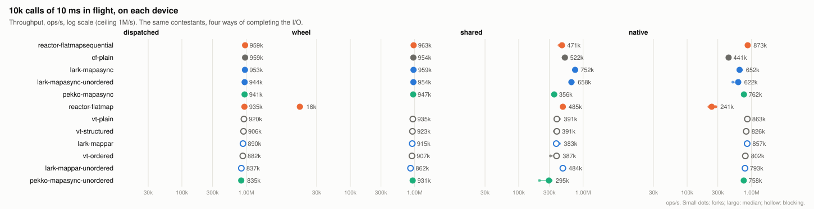
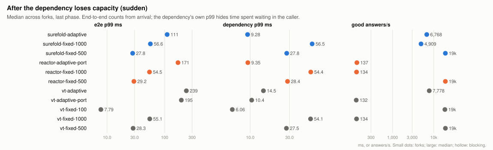
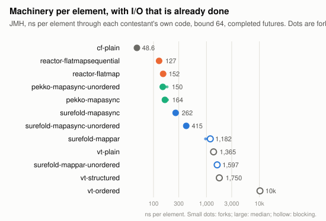

# Blocking vs reactive on the JVM

An investigation of what blocking on virtual threads costs against composing asynchronous operations, and how
[Surefold](https://github.com/matthewjones372/lark), Project Reactor and Pekko Streams compare at the same work. Every
number here comes from `results/`, produced by the commands under [Reproducing](#reproducing) on one 4-core
cloud VM; each table names the commit it ran at. How the experiments are built is in
[`docs/METHODOLOGY.md`](docs/METHODOLOGY.md); what was wrong with the earlier version of this benchmark, and what
changed, is in [`docs/AUDIT.md`](docs/AUDIT.md).

## Is reactive programming still necessary in 2026?

**No, not as the default.** On JDK 21 or later, a service that handles requests by calling other services over
the network can block on virtual threads instead. At ordinary concurrency and over real sockets, blocking code
matched Reactor and Pekko on throughput, held backpressure just as well, and gave stack traces and thread dumps that
name the waiting call. The price is about 1 KB of memory and a few microseconds of CPU per waiting call. It cost
throughput only with ten thousand or more calls in flight on synthetic I/O, and it disappeared behind a real HTTP
client's own cost. (Databases were not tested; see caveats.)

**Some jobs still call for a stream library, but not for the reactive model.** Pipelines with operators (merging
streams, time windows, retries) and many producers feeding one slow consumer go better with a stream library than
with hand-written threads. Surefold is a stream library that runs on virtual threads, and it did both: it has the
operators, and behind a slow consumer it matched Reactor (47.2–47.8k against 47.2–47.9k ops/s), including with
`mapPar`, which blocks a virtual thread per call. What still
favoured Reactor or Pekko was narrow:

- calls that do real CPU work: with about 30 µs of work per call, Reactor `flatMapSequential` led at 58.1k ops/s,
  Reactor `flatMap`, Pekko and plain virtual threads reached 48.7–50.8k, and Surefold 41.0–46.5k (0.70–0.80). Plain
  virtual threads beat Surefold here, so this is a gap in Surefold, not in the virtual-thread engine; its cause is not
  isolated (finding 10). The CPU-only operator chain (finding 13) is not evidence either way: Reactor's lead there
  is about 2 ns per element, which any real work per element hides;
- time-based rate operators (`throttle`, `debounce`), which Surefold does not have;
- demand sent to a remote producer: Surefold can consume a Reactive Streams `Publisher` but cannot expose one.

### The evidence, question by question

| Question | Verdict | Evidence |
|---|---|---|
| Is blocking on virtual threads as fast as reactive code? | **Yes, at ordinary concurrency.** At 1,000 calls in flight every contestant, blocking or not, reached 93–97% of the I/O ceiling, all tied. Over real sockets, blocking calls tied with Reactor, Pekko and futures, and with the JDK HTTP client, blocking `send` was at or tied with the fastest. | findings 2, 6 |
| What does blocking cost? | **More CPU and memory per waiting call.** Parking a virtual thread cost 3.9–5.3 µs of CPU per call against 1.2–2.8 µs for a future, and about 1 KB of heap per pending call against 80–200 B. It showed only at very high completion rates (0.75–0.89 of the best at 10,000 in flight on synthetic I/O), and it disappeared behind a real HTTP client's own cost. | 3, 4, 5, 6 |
| Is backpressure as easy without reactive code? | **Yes, if you write the bound.** A `Semaphore` or a bounded queue held the bound exactly as Reactor and Pekko did. An unbounded thread per element did not. | [`docs/backpressure.md`](docs/backpressure.md) |
| Does Surefold beat Reactor, as the original README claimed (1.6–1.9×)? | **No.** That result measured the fake device, not the libraries. On a device that keeps up, Surefold `mapAsync` and Reactor `flatMap` tie at 10,000 in flight (942k against 895k ops/s). Surefold led only when the machine ran out of CPU at 100,000 in flight, within 26% noise. Reactor was faster on CPU-only operator chains (1.11×). | 1, 5, 13 |
| Does Surefold's adaptive limit protect a service when a dependency loses capacity? | **It protects the dependency, not the caller.** The dependency's p99 stayed at 9 ms, but the queue moved into the caller: end-to-end p99 was 111 ms, against 28–29 ms with a fixed limit of 500. It won clearly when the dependency rejects calls or the callers have deadlines. | 11, [`docs/adaptive-limit.md`](docs/adaptive-limit.md) |
| What mattered more than blocking against reactive? | **Ordering, and the client library.** Under variable latency, ordered pipelines of every model fell to 14–15% of the unordered ones' throughput. The JDK `HttpClient` cost about three times the CPU per request of a raw socket client, whatever the model. | 6, 7 |
| Where do reactive libraries still earn their place? | **Narrowly.** A stream library beats hand-written virtual threads for pipelines with one slow consumer (more than twice as fast) and supplies the operators, but Surefold, a stream library on virtual threads, matched Reactor behind the slow consumer and has the operators. Reactor and Pekko kept calls with real CPU work (Surefold 0.70–0.80 of Reactor's best, behind plain virtual threads too, cause not isolated), time-based rate operators, and exposing demand to a remote producer, which Surefold lacks. | 9, 13, [`docs/backpressure.md`](docs/backpressure.md) |

These verdicts come from one 4-core cloud VM, loopback sockets and synthetic dependencies (caveats, section 6).
They are about the shape of the costs, not margins to bank on another machine.

## 1. The questions

| | Question | Where it is answered |
|---|---|---|
| Q1 | Does Project Loom remove the need for asynchronous or reactive code? | Not directly measurable. Q2–Q4 and the semantics checks answer the parts that are; the answer above puts them together. |
| Q2 | What does waiting by parking a virtual thread cost, against composing a future, for the same I/O? | I/O, workload, socket and memory suites; per-element JMH |
| Q3 | How do Surefold, Reactor and Pekko compare at the same job? | The same suites, comparing within one model (async with async, ordered with ordered) |
| Q4 | How do fixed and adaptive concurrency limits behave when a dependency loses capacity? | The overload suite, a factorial of model × policy |

Surefold is on both sides of Q2: `mapPar` parks a virtual thread per element, `mapAsync` composes a
`CompletionStage` and parks nothing per element. Surefold `mapAsync` beating Reactor is a result about two
asynchronous implementations (Q3), not about blocking against reactive.

## 2. The models

| model | contestants | waits by | order |
|---|---|---|---|
| plain blocking | `vt-plain`, `vt-ordered` | a parked virtual thread per call, `Semaphore` bound | completion; start order |
| structured blocking | `vt-structured` | the same, inside a `StructuredTaskScope` (JDK 25 preview) | completion |
| blocking in a stream | `surefold-mappar`, `surefold-mappar-unordered` | a virtual thread per element in Surefold's window | start order; completion |
| async composition | `cf-plain`, `surefold-mapasync`, `surefold-mapasync-unordered` | a callback on a `CompletableFuture`, or Surefold's pull loop polling the head | completion; start order; completion |
| reactive streams | `reactor-flatmap`, `reactor-flatmapsequential`, `pekko-mapasync`, `pekko-mapasync-unordered` | `Mono.fromFuture` / Pekko's async callback, demand-driven | completion; start order; start order; completion |

All of them bound the calls in flight and stop reading their source at the bound. They differ in where the next
step runs (Reactor's drain runs on the completing thread, Pekko's on its stream actor, a blocked virtual thread on
its carrier), in whether demand crosses an asynchronous boundary (Reactive Streams) or is implicit in a loop that
does not call `next()`, and in what a stop does (section 7). Adaptive concurrency is a policy layered on any of
them, and is measured separately (Q4).

Why a bounded loop of blocking calls on virtual threads gets backpressure without a demand protocol, with
pseudocode, diagrams and the measurements behind it: [`docs/backpressure.md`](docs/backpressure.md).

How Surefold's adaptive `Limit` (TCP Vegas) decides its concurrency, and why it moves the queue to the caller:
[`docs/adaptive-limit.md`](docs/adaptive-limit.md).

## 3. Experimental design

- **One contract for every contestant.** The same counted source, I/O call, bound and sink; every iteration's sum
  and count are checked, and a run with the wrong answer is excluded and listed. Code per contestant is between
  `region` markers in [`Contestants.kt`](src/main/kotlin/bvr/Contestants.kt).
- **Four synthetic devices**, because the device decides who wins at high concurrency (finding 1): the original
  two-thread `ScheduledThreadPoolExecutor` (`shared`); a timing wheel completing on its own thread (`wheel`); the
  same wheel handing completions to a separate pool (`dispatched`, the default); and each model's own timer
  (`native`). Every run records the device's lag against its deadlines.
- **Real sockets**: a separate-JVM HTTP server pinned to one core (NIO, or main's Netty server as a cross-check);
  blocking-socket and async-NIO clients with the same protocol code, the JDK `HttpClient`'s `send` and
  `sendAsync`, and Reactor Netty's client. A diagnostic suite separates ordering from Surefold's refill.
- **Memory** at a held, steady state: exactly `n` calls pending and nothing moving, live bytes from a class
  histogram at two bounds, and the slope between them.
- **Overload**: capacity changes on a wall clock; latency per element from its arrival, phases by arrival time.
- **Statistics**: each cell in 3–5 fresh JVMs, run in an order shuffled afresh each round; a JVM fork is one sample;
  medians with bootstrap 95% intervals; a difference is reported only when its interval clears the table's
  measured noise floor (at least 5%). Otherwise the tables say *tie*.

## 4. Reproducing

```bash
export JAVA_HOME=/path/to/jdk-25            # Temurin 25.0.5 was used
scripts/build-surefold.sh                       # Surefold at surefold.commit, into ~/.m2 as 0.0.0-cand-SNAPSHOT
./gradlew test                              # correctness and semantics: 187 tests, about two minutes
scripts/run-all.sh                          # every suite (about seven hours on 4 cores), then the summaries
python3 scripts/charts.py                   # docs/charts/*.svg from the summaries
```

Single suites: `scripts/run-suite.py <io|workload|memory|overload|net|net-diag> --forks N`, then
`scripts/summarise.py <suite>`. `scripts/run-jmh.sh` runs the JMH benchmarks. CI compiles, runs the tests and
drives every harness at smoke size; it does not measure. Surefold comes from a commit on its `main` branch
(`surefold.commit`, `575a944e`), because the overload experiment needs Surefold's `Limit`, which no release has yet and
which the one published snapshot (`0.10.2-20261022.045955-6`) predates.

## 5. Main findings

Medians across forks, with the 95% interval where it matters. "Ceiling" is concurrency ÷ latency. Every
comparison is between contestants measured in the same run; absolute numbers moved between runs on this machine
(caveats).

**1. The original 10k and 100k results measured the fake device, not the contestants.** The two-thread
`ScheduledThreadPoolExecutor` saturates near 550k calls/s, and runs contestants' callbacks on its own threads, so
the contestant that puts least work on the completing thread looked fastest. At 10,000 calls of 10 ms in flight
(ceiling 1M/s) on that device, Surefold `mapAsync` leads at 652k against Reactor `flatMap`'s 487k (0.75); on a device
that keeps up (`dispatched`) they are 942k and 895k, a tie, and every contestant reaches 71–95% of the ceiling.
Rankings at 10k correlate weakly across devices (Spearman ρ against `dispatched`: 0.76 `wheel`, 0.63 `shared`,
−0.14 `native`). → [`results/io/summary.md`](results/io/summary.md), 

**2. At ordinary concurrency every model is limited by the I/O, not by itself.** 1,000 calls of 10 ms (ceiling
100k/s): all twelve bounded contestants reach 93.3–96.8k ops/s, every one a tie with the best. 10,000 calls of
100 ms, calls failing 1 in 100 and recovered, and lognormal latency for unordered contestants: ties within 5%.

**3. Parking a virtual thread costs more CPU per call than composing a future, and it shows when completions are
frequent.** On the dispatched device at 10,000 in flight: 3.9–5.3 µs of CPU per call for the parked contestants
against 1.2–2.8 µs for the asynchronous ones; throughput 0.75–0.89 of the best against 0.94–1.0. Pekko
`mapAsyncUnordered` is the exception on the async side: 3.8 µs and 0.81, with 1,961 answers on average waiting for
its one stage. With 1 ms calls at 1,000 in flight (a completion rate near 780k/s): 4.7–5.6 µs and 0.74–0.86 of the
best for blocking, 1.4–4.1 µs and 0.85–1.0 for async. With socket clients that do real work per call the gap
disappears (finding 6).

**4. Retained memory per pending call: about 0.9–1.2 KB for a parked virtual thread, 80–200 B for a pending
future.** Held at 100,000 pending, the slope between 10k and 100k is 79 B for Surefold's ordered `mapAsync`, 146–158 B
for `cf-plain`, Surefold's unordered `mapAsync` and Pekko's unordered `mapAsync`, 188–200 B for Pekko's ordered
`mapAsync` and both Reactor operators, and 859–1,226 B for every blocking contestant, about half of it the virtual
thread's stack chunk. An answered-but-unconsumed element behind a held head costs 60–141 B in the stream libraries
and 353 B in `vt-ordered`. → [`results/memory/summary.md`](results/memory/summary.md)

**5. At 100,000 in flight the machine runs out of CPU, and the frugal async code leads, within wide noise.** On the
dispatched device (ceiling 10M/s) the cells varied so much between forks that the noise floor is 26%: Surefold
`mapAsync` 2.95M ops/s at 0.95 µs/call, with `cf-plain` (2.59M), Reactor `flatMapSequential` (2.36M), Surefold's
unordered `mapAsync` (2.06M) and Reactor `flatMap` (1.84M) all ties; plain virtual threads 1.58M (0.54), the other
parked contestants 0.86–1.15M (0.29–0.39), Pekko 0.75–0.83M (0.25–0.28). The device lags by 7–20 ms at p99 (54 ms
and 482 ms for Pekko): this is a CPU-saturation result, which a machine with more cores would move.

**6. Over real sockets the client library matters more than the concurrency model, and ordering costs more than
the library.** Every contestant in the socket suite is unordered. With the raw clients (same protocol code,
blocking socket against `AsynchronousSocketChannel`), plain virtual threads, `cf-plain`, Reactor and Pekko reach
19–34k requests/s from 64 to 1,000 in flight, with the one-core server at 0.84–0.98 of its core, and Surefold's
unordered `mapPar` and `mapAsync` are at 0.76–0.97 of the best: every difference is inside the run's noise floor
of 10–22%. An earlier version of the suite put Surefold's *ordered* operators against the others and found them 17–26%
behind ([`docs/AUDIT.md`](docs/AUDIT.md) A16). A diagnostic suite, run separately
([`results/net-diag/summary.md`](results/net-diag/summary.md); compare numbers only within each run), separates
the causes:

- *Ordering.* At 1,000 in flight every ordered contestant, from every library, is 0.79–0.84 of the best, each
  holding 44–54 answered calls behind a slower head; Surefold's unordered `mapAsync` is the fastest contestant.
- *Surefold's batched refill.* At 64 in flight every Surefold operator, ordered or not, is 0.83–0.85 of the best. Surefold's
  window wakes its waiting feeder only once a quarter of the window, at most 64, has freed; plain virtual threads
  refilling the same way (`vt-batched`, a diagnostic contestant) lose 10% against `vt-plain`, with the same shortfall
  of calls in flight (56–58 of 64, against 63). Latency per call does not change. At 256 and 1,000 in flight the
  effect is mostly within the noise. The socket suite shows the same shortfall (Surefold 55 of 64 in flight, the others
  62–63) inside its wider noise. Reported to Surefold as [surefold#589](https://github.com/matthewjones372/lark/issues/589).
- *At 10,000 in flight* Surefold `mapAsync` is the best; the blocking contestants of every kind are 0.86–0.90, at
  86–91 µs of CPU per request against 65–78 µs.

With the JDK `HttpClient`, everyone spends 141–239 µs of CPU per request in the client and reaches 10.1–17.1k/s from
64 to 1,000 in flight. Blocking `send` (plain virtual threads, Surefold `mapPar`) is at or tied with the top in all three
scenarios; at 64 in flight `cf-plain`, Pekko and Surefold `mapAsync` are behind at 0.73–0.79. At 10,000 connections every
contestant falls to 7.2–8.9k/s at 240–324 µs per request, all ties: Surefold's ordered operators had collapsed there
(0.28–0.34 of the best at 469–667 µs per request), and the unordered ones do not, so that was the ordered window,
not Surefold. Reactor Netty's client reaches 17.9–30.1k/s at 56–101 µs per request from 64 to 1,000 in flight, against
41–82 µs for the raw clients, and about 16k/s at 10,000. Against main's Netty server instead of the NIO one, at 1,000
in flight, everyone is faster (34.0–36.9k against 24.5–32.2k, the server at three-quarters of its core rather than
all of it), and every contestant ties. Platform poller threads (`-Djdk.pollerMode=1`) and two carriers instead of
four (`-Djdk.virtualThreadScheduler.parallelism=2`) moved plain virtual threads by no more than the noise floor
(10–22% here), at 1,000 or 10,000 in flight. → [`results/net/summary.md`](results/net/summary.md)

**7. Ordering costs far more than the choice of model when latency varies.** Lognormal latency (median 5 ms, 1,000
in flight): every unordered contestant reaches 108–112k ops/s, every ordered one 16.1–16.2k, blocking or not, Surefold,
Reactor or Pekko, because the window waits behind its slowest head. → [`results/workload/summary.md`](results/workload/summary.md)

**8. Reactor's `flatMap` has a cliff when completions arrive one at a time on one thread.** Its drain visits every
inner subscriber each pass. With completions serialised on one thread (`wheel` device at 10k; `Mono.delay` at
100k in flight) it falls to 10.0k and 10.4k ops/s at 100–103 µs of CPU per call. `flatMapSequential` does not, and
with completions spread over threads (`dispatched`) `flatMap` ties with the best at 10k. The original README's 11k
ops/s "Reactor at an extreme" is this.

**9. A slow consumer favours models with one downstream.** A serial consumer at about 10 µs per element: Reactor,
Pekko's ordered `mapAsync` and every Surefold operator reach 47.2–47.9k ops/s, Pekko's unordered `mapAsync` 42.2k;
`vt-ordered` 36.5k; `cf-plain`, `vt-plain` and `vt-structured`, whose sink runs inside each call's task, 19.4–25.5k,
because their threads convoy on the consumer's lock (and `cf-plain`'s convoy forms on the device's dispatch
threads, lagging it by 41 ms).

**10. CPU work per element does not separate the models cleanly.** A CPU step of about 30 µs on each answer at
1,000 in flight: Reactor `flatMapSequential` 58.1k ops/s (best), everyone else 41.0–50.8k, with Reactor `flatMap`,
`cf-plain`, Pekko, `vt-plain` and `vt-structured` at 48.7–50.8k, Surefold `mapAsync` at 46.5k, and the ordered blocking
contestants and Surefold's unordered operators at 41.0–44.2k. Asynchronous contestants run the step on the four
dispatch threads, blocking ones on the four carriers. Every contestant spends 67–95 µs of CPU per call on a step of
about 30 µs, so what separates them is how each shares four cores between the work, the completions and its own
coordination; why Surefold's operators and `vt-ordered` sit lowest is not isolated.

**11. Adaptive concurrency moves the queue rather than removing it; its clear wins are against a dependency that
rejects and against arrivals with a deadline.** The overload factorial (dependency capacity 500, then 100; 5 ms
service; 4 forks) gives the same result for a fixed bound whatever the model: plain virtual threads, Surefold and
Reactor are within a few percent of each other in every pattern, so the policy is what matters.

- *Sudden loss, closed loop.* After the drop every policy serves 17.8–19.2k calls/s of a possible 20k. A fixed bound
  of 500 gives an end-to-end p99 of 27.8–29.2 ms; 1,000 gives 54.5–56.6 ms. Surefold's adaptive `Limit` keeps the
  dependency's own p99 at 9.3 ms but the caller's end-to-end p99 at 111 ms (`vt-adaptive`, the same `Limit` driving
  plain virtual threads: 239 ms), because elements now wait for a permit in the caller's window instead of in the
  dependency's queue; it answers 6.8–7.8k calls/s within 50 ms of arrival, against 19.1–19.2k for a fixed bound of
  500. Before the drop the adaptive limit costs 4–7% of throughput (88.6–90.0k against 93.6–94.8k for a fixed bound
  of 1,000) and raises the limit back within 0.2–0.25 s.
- *Rejecting dependency* (rejects beyond 200 queued). A fixed bound of 1,000 collapses to near zero after the drop
  (1.2–1.4M rejections: the closed loop retries at once), 500 to 8–16k/s; every adaptive policy keeps 18.1–19.1k/s
  with 5–7 rejections in the whole run, because a rejected call backs the limit off.
- *Recovery.* When capacity returns, fixed bounds reclaim it within milliseconds; Surefold's `Limit` takes 157–216 ms.
- *Open loop with a deadline.* Arrivals at 60k/s exceed the degraded capacity threefold. With a 500 ms deadline,
  fixed bounds answer about 4.6k/s in time, Surefold's `Limit` 5.3–9.6k/s, the ported limit 2.9–3.0k/s. With 50 ms, fixed bounds answer almost
  nothing in time (about 400/s); Surefold's adaptive `Limit` 7.4k/s, the same `Limit` driving plain virtual threads
  0.6k/s. Treat the *good/s* columns as sensitive: with the post-drop median latency close to the threshold, small
  shifts move many calls across it.
- The ported limit Reactor needs (`AsyncLimit`, Surefold's Vegas arithmetic with a non-blocking acquire) has not kept up
  with Surefold's retuning: it costs 15% of throughput before the drop (79.7–80.0k) and takes 0.6–1.0 s to raise the
  limit. Reactor with the port still collapses in the open-loop patterns: see open questions.
- Against Surefold `3ccde44`, measured in an earlier run, the adaptive limit cost 15–18% of throughput before the drop,
  took 0.85–1.1 s to raise the limit, and gave an end-to-end p99 after the drop of 173–247 ms: Surefold's spec 0187
  narrowed the cost and the tail, and the fixed-bound controls of both runs agree to within a few percent.
→ [`results/overload/summary.md`](results/overload/summary.md), 

**12. Operational behaviour differs in ways a benchmark score does not show.** From
[`docs/semantics.md`](docs/semantics.md): a blocking contestant's pending calls are threads in a thread dump (100
of 100 with the call site on the stack), an async one's are invisible (0 of 100). Reactor cancels every pending
future on `take`, on a failure and on an interrupt; blocking contestants interrupt their threads; Surefold
`mapAsyncUnordered`, Pekko and `cf-plain` leave callbacks on calls still in flight. Interrupting a caller waiting on
a Surefold run with Surefold's `await()` returns control but leaves the run going ([`docs/surefold-issues.md`](docs/surefold-issues.md)).
Ordered Surefold and `vt-ordered` report a failure only after earlier calls answer; Reactor and Pekko fail at once. A
blocking failure names the handler and the failed fetch in its stack trace; Surefold `mapAsync`, `cf-plain` and Pekko
name neither; Reactor names the handler through `block()`, and the fetch only with `checkpoint()`.

**13. Without I/O, per-element machinery separates the models by an order of magnitude, and Reactor leads the
CPU-only cases.** JMH, five forks, 99.9% intervals in [`results/jmh/summary.md`](results/jmh/summary.md):

- *Per element with already-completed I/O* (100,000 elements, bound 64): a bare `CompletableFuture` loop 49 ns;
  Reactor and Pekko 129–167 ns; Surefold `mapAsync` 266 ns, unordered 415 ns; blocking contestants, which still start a
  virtual thread per element, 1,125–1,768 ns, and `vt-ordered`, which parks the consumer on every future, 10.3 µs.
  This is what each model adds to whatever the I/O costs.
- *Hand-off between threads* (a million ints, buffer 256): Reactor `publishOn` 25 ms, Surefold `buffer` 46 ms, an
  `ArrayBlockingQueue` between two virtual threads 450 ms, Pekko's async boundary 1.15 s. These are not like for
  like. Reactor's synchronous source ends up running on the consumer's thread, so all but one of its million
  elements never cross threads; Pekko's cross for 67% of them, Surefold's and the queue's for all. The finding was made
  on main and checked here (`docs/AUDIT.md` A15).
- *CPU-only chain* (map, filter, map, sum over a million ints): a plain loop 0.87 ms, `Sequence` 11.5 ms, Reactor
  16.0 ms, Surefold 17.8 ms (1.11× Reactor, allocating 56 MB per million elements to Reactor's 28 MB), Pekko 105 ms.
  The gap between Reactor and Surefold is about 2 ns per element over four trivial steps; with real work per element it
  disappears, so this measures operator overhead, not suitability for CPU-bound work (finding 10 is that).
→ 

## 6. Important caveats

- **One 4-core VM, shared hardware, no frequency control.** Within a run the calibration loop varied with a
  coefficient of variation of 1.6–2.1% across JVMs; differences under the tables' noise floors (5–26%) are reported
  as ties.
- **The machine's speed changed between runs, and the calibration loop did not see it.** In the I/O suite's run
  for these results, contestants that do not involve Surefold at all (plain virtual threads on the shared device,
  `cf-plain` and Reactor `flatMap` at 100k) ran at 0.71–0.78 of their speed in the previous run, with CPU per call
  up by a similar factor, while the single-threaded calibration loop moved by 1.6%. Contention for the host's
  shared resources from other tenants is the likely cause. Only comparisons within one run are drawn here; the
  100k cells, run in the slowest stretch, carry a 26% noise floor.
- **Warm-up.** Two warm-up iterations left JIT compilation in measured iterations at a median of 62–110 ms; the
  last measured iteration of a fork was within 0.84–1.22 of the first for 90% of cells. The socket suite compiled
  more (90th percentile 0.72 s per measured iteration, mostly the JDK `HttpClient`), so its first iterations are
  slightly pessimistic.
- **Four cores flatter serial designs.** A single drain loop or stream actor competes with three other cores here,
  not thirty; the dispatch pool and the contestant also share those cores.
- **Synthetic I/O is a model.** Findings 1, 8 and the `native` rows show how much a result depends on which thread
  completes a call; the dispatched device is a choice, documented in the methodology, not neutral ground.
- **Loopback sockets** exercise the kernel and the clients, not a network, and the servers have one core.
- **Not covered**: Pekko HTTP, Kotlin coroutines, JDBC or any blocking client inside a reactive pipeline
  (`subscribeOn(boundedElastic())`), and machines with many cores.

## 7. Detailed results

| suite | summary | raw |
|---|---|---|
| I/O sweep: 1k, 10k, 100k in flight on four devices; backpressure | [`results/io/summary.md`](results/io/summary.md) | `results/io/*.jsonl` |
| workload matrix: short, long, CPU, lognormal, errors, slow consumer | [`results/workload/summary.md`](results/workload/summary.md) | `results/workload/` |
| sockets: raw, JDK and Reactor Netty clients; NIO and Netty servers; scheduler settings | [`results/net/summary.md`](results/net/summary.md) | `results/net/` |
| why Surefold trails on raw sockets | [`results/net-diag/summary.md`](results/net-diag/summary.md) | `results/net-diag/` |
| memory | [`results/memory/summary.md`](results/memory/summary.md) | `results/memory/` |
| overload | [`results/overload/summary.md`](results/overload/summary.md) | `results/overload/` |
| JMH | [`results/jmh/summary.md`](results/jmh/summary.md) | `results/jmh/jmh.json` |
| semantics, thread dumps, stack traces, hand-off threads | [`docs/semantics.md`](docs/semantics.md) | `results/semantics/` |

Lines of code per contestant (`scripts/loc.py`, including the failure, stop and interrupt handling the semantics
tests require): the stream DSLs 7 each; `cf-plain` 32; `vt-plain` 35; `vt-ordered` 39; `vt-structured` 40.

## 8. Limitations and open questions

- Whether the CPU-per-call gap between parked threads and futures (finding 3) matters in a service depends on what
  else a call costs; with a real HTTP client (finding 6) it was lost in the client's own cost.
- Surefold's batched refill (finding 6) is a deliberate trade (Surefold spec 0172: fewer wake-ups for the feeder); its cost
  is measured here only over loopback sockets at 64 in flight ([`docs/surefold-issues.md`](docs/surefold-issues.md),
  [surefold#589](https://github.com/matthewjones372/lark/issues/589)).
- Reactor with the ported adaptive limit collapses under open-loop load with a deadline: the limit falls to single
  digits while the dependency is idle, so Vegas is reading inflated call times. Pulling the source on its own
  worker (`subscribeOn`) and letting arrivals take free permits ahead of older waiters, as Surefold's `Limit` does, did
  not change it, and the process is not CPU-bound. The cause is not isolated; the row says nothing about Reactor
  itself, and Netflix's `concurrency-limits` or another production limiter would be the fairer Reactor contestant.
  The port also predates Surefold's spec 0187 retuning, which it does not copy.
- Pekko's async hand-off (JMH) and its single-stage completion processing (finding 5) were not tuned beyond
  documented settings; a Pekko maintainer may know better.
- A 4-core result is not a 64-core result; the suites are ready to rerun on a larger machine.

## Licence

[Apache 2.0](LICENSE), as Surefold is.
