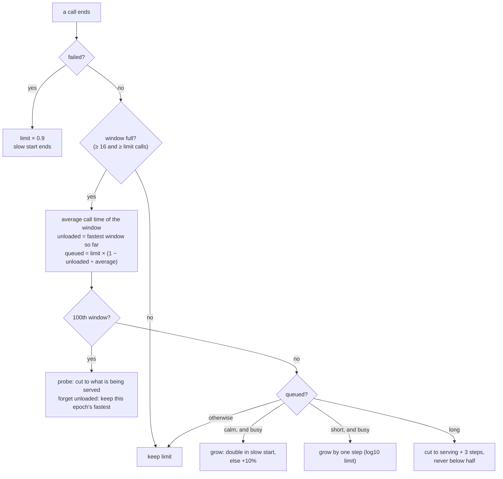
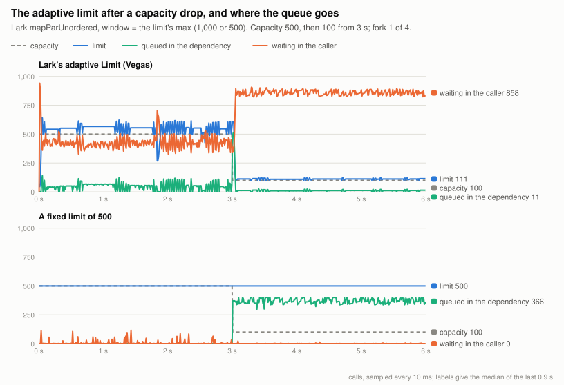

# How the adaptive limit works

Lark's `Limit.adaptive` decides, while it runs, how many calls may be inside a dependency at once. It uses TCP
Vegas's idea: a call that takes longer than the dependency takes when idle must have waited in a queue. This page
walks through the algorithm as Lark implements it (`Vegas.kt` and `Limit.kt` in lark-core at `575a944e`, specs
0171 and 0187), shows it running in this repository's overload suite, and explains why it moves the queue rather
than removing it. The ported version used for Reactor is covered at the end.

## The problem it solves

Little's law ties three numbers together: calls in flight = throughput × time per call. A dependency that serves
100 calls at once, each in 5 ms, completes 20,000 calls a second. Send it 150 at once and the extra 50 queue
inside it, so every call takes 7.5 ms and throughput stays at 20,000. Send it 80 and nothing queues, but a fifth of
its capacity goes unused.

A fixed bound is right only for one capacity. When a replica fails and capacity drops from 500 to 100, a bound of
500 leaves 400 calls queueing inside the dependency, and every caller's timeout feels it. An adaptive limit tries
to track the capacity from the only signal a caller has, which is how long its calls take.

## The idea in one formula

If the fastest the dependency has ever answered is `unloaded`, and calls now take `took` on average with `limit`
of them in flight, then the share of that time spent queueing is `1 - unloaded / took`, and about

```
queued ≈ limit × (1 − unloaded / took)
```

of the calls in flight are waiting rather than being served. In the example above: 150 × (1 − 5 / 7.5) = 50. The
limit grows while `queued` is close to zero and shrinks when it is large. The calls actually being served,
`serving ≈ limit × unloaded / took` (100 here), say where to cut to.

## One window's decision

Each release feeds `Vegas.sample(took, inFlight, dropped)`. Calls accumulate until the window is full, at least
16 calls and at least `limit` calls. Then the limit moves once:



In code, simplified from `Vegas.kt`:

```kotlin
fun sample(took: Long, inFlight: Int, failed: Boolean): Int {
    if (failed) { limit = max(min, limit * 0.9); slowStart = false; return limit }
    window.add(took, inFlight)
    if (window.calls < max(16, limit)) return limit           // decide once per window, not per call

    val average = window.averageTook
    unloaded = min(unloaded, average)                          // the fastest window ever seen
    val queued  = limit * (1 - unloaded / average)             // Vegas: calls waiting, not being served
    val serving = max(limit, window.averageInside) * unloaded / average
    val busy    = window.mostInside >= limit / 2               // an idle limit must not creep upwards
    val step    = max(1.0, log10(limit))
    if (queued >= max(1.0, limit * 0.02)) slowStart = false

    limit = when {
        ++windows % 100 == 0L                            -> min(limit, max(serving, limit / 2))   // probe; then forget
        queued < max(1.0, limit * 0.02) && busy          -> limit + max(step, limit * if (slowStart) 1.0 else 0.1)
        queued <= max(3 * step, limit * 0.05) && busy    -> limit + step
        queued >= max(6 * step, limit * 0.15)            -> min(limit, max(serving + 3 * step, limit / 2))
        else                                             -> limit
    }.coerceIn(min, max)
    return limit
}
```

Why each piece is there, from the comments in Lark's source:

- **Windows, not calls.** The fastest single call is luck. Comparing every call with it would read ordinary jitter
  as queueing, and more so the higher the limit.
- **Thresholds that scale with the limit.** A few percent of jitter reads as that many percent of the limit
  queueing. At a limit of hundreds, that is past any fixed number of calls.
- **Slow start.** Starting at 20 and adding a step per window would take seconds to reach hundreds. Doubling
  while nothing queues reaches them in a few windows, as TCP's slow start does.
- **Cut to what is served, not by a fraction.** When the queue is long, the dependency's own answer rate says
  where the limit should be. Lark cuts straight there, plus a short queue, and never by more than half at once.
- **The periodic probe.** A dependency that queues throughout an epoch would teach the limit a slower `unloaded`,
  and the limit would queue more each epoch. Once every 100 windows it drops to what is being served, so every
  epoch has a window with no queue in it (BBR probes for its round-trip time the same way). Then `unloaded` is
  reset to that epoch's fastest window, so a dependency that has slowed for good is not read as queueing forever.
- **Only a busy limit grows.** Otherwise quiet calls on an idle limit would push it to `max`.

The permits themselves are a lock and a condition (`Limit.kt`). `acquire` waits while `inFlight >= limit`.
`release` feeds the call's time to Vegas and signals one waiter, or all of them if the limit grew. A call that
throws counts as a dependency failure, unless it was interrupted or cancelled, or the exception is a declared
`fail`, the call's own answer: none of those says anything about the dependency's capacity.

## Watching it run

The `sudden` overload pattern gives the dependency a capacity of 500 calls at 5 ms each, then 100 from 3 s, as if
a replica failed. The chart is one fork of Lark `mapParUnordered` with the adaptive limit, beside the same stream
with a fixed limit of 500.



Reading the top panel:

1. **Slow start.** The limit starts at 20 and doubles each window. The dependency is fully used within 47 ms.
2. **Settling.** The first windows overshoot to about 640 and queue, so the limit is cut to what is being served
   plus a short queue. It then moves between about 510 and 610, with typically 10–100 calls queued inside the
   dependency.
3. **The drop.** At 3 s capacity falls to 100. Within two windows the limit falls from 554 to 152 and then to
   112, and the dependency's queue falls to about 11. The dependency's p99 stays near 9 ms.
4. **Where the rest went.** The stream still holds 1,000 elements, the limit's maximum, but only about 111 may be
   inside the dependency. The other 858 wait for a permit in the caller.

The bottom panel is the fixed limit of 500. It lets in only 500, and after the drop 366 of them queue inside the
dependency instead. Nothing waits in the caller.

So the adaptive limit protects the dependency but not the caller. Across the four forks, the caller's end-to-end
p99 after the drop is 111 ms with the adaptive limit, against 27.8 ms with a fixed limit of 500. Answers within
50 ms of arrival run at 6.8k/s against 19.2k/s ([`results/overload/summary.md`](../results/overload/summary.md),
README finding 11).

## When moving the queue helps, and when it doesn't

Moving the queue out of the dependency is the right thing when the queue inside it costs something the
caller's queue does not:

- **A dependency that rejects when overloaded.** Each rejection is a failure, which backs the limit off. Adaptive
  policies kept 18.1–19.1k calls/s with 5–7 rejections in the whole run. A fixed bound of 1,000 collapsed to near
  zero under 1.2–1.4M rejections, because the closed loop retries at once.
- **Callers with a deadline.** An element that waits in the caller can be dropped before it costs the dependency
  anything. With arrivals at 60k/s and a 50 ms deadline, Lark's adaptive limit answered 7.4k/s in time against
  about 400/s for every fixed bound.
- **Other callers of the same dependency.** One `Limit` value shared by every caller bounds them all together,
  so a dependency queue that one caller would fill stays short for everyone.

It does not help when the caller holds as many elements as before and simply waits longer. That is the closed
loop above: the stream admits 1,000 elements regardless, so the queue changes place but not size. To shorten it,
the work has to leave the caller as well: a deadline, load shedding at the edge, or an upstream bound sized
against the limit rather than its maximum.

## The port used for Reactor

Reactor's operators may not block, and `Limit.acquire` waits on a condition. So the overload suite uses a port,
[`AsyncLimit.kt`](../src/main/kotlin/bvr/AsyncLimit.kt). Its `acquire` returns a future that completes when a
permit is free. Lark's barging is kept: a caller that finds a free permit takes it ahead of waiters, and
releases go through a per-thread trampoline so a chain of failing calls cannot overflow the stack. Its Vegas
arithmetic is Lark's as of `3ccde44` (spec 0171), before spec 0187. It has no slow start, no thresholds that
scale with the limit, no cut to what is being served, and no periodic probe; it forgets `unloaded` by overwriting
it every 100 windows. The measurements show that difference: the port costs 15% of throughput before the drop
against 4–7% for Lark's own limit, and takes 0.6–1.0 s rather than 0.2–0.25 s to raise the limit again.
Reactor with the port also collapses under open-loop load, for reasons not yet isolated (README, open questions).
