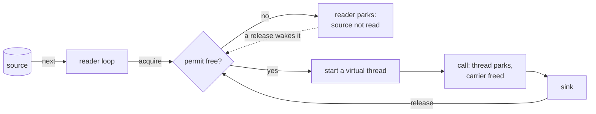
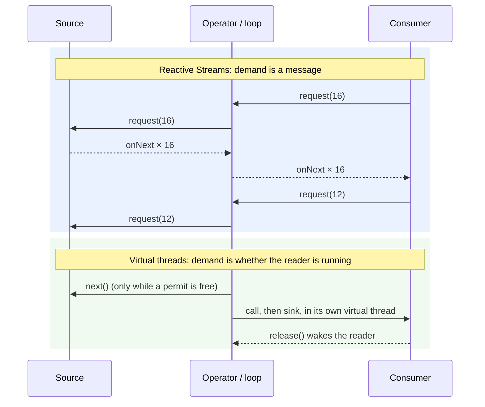

# Why backpressure is easy on virtual threads

Backpressure means that a fast producer slows down to the speed of whatever consumes its output, rather than
filling memory with work nobody has taken yet. This page explains why blocking code on virtual threads gets this
almost for free, what it still requires of you, and where it stops being enough. The numbers are from this
repository's suites.

## The short version

A reactive library cannot let a thread wait, because its threads are shared and scarce. So "I am not ready for
more" has to travel upstream as data: a demand count, `request(n)`, that every operator must track, honour and
pass on.

A virtual thread can wait, because a parked virtual thread costs about a kilobyte of heap and no platform
thread. So "I am not ready for more" is expressed by not returning. The producer blocks in `acquire()` or `put()`
and does not read its next element until it is unblocked. The demand count is replaced by the call stack, and
the stack is where the state already lives.

## Reactive: demand is a protocol

In Reactive Streams, a subscriber grants demand explicitly, and a publisher may emit only what has been granted:

```kotlin
// Subscriber: ask for 16, then top up as elements are processed.
override fun onSubscribe(s: Subscription) { subscription = s; s.request(16) }

override fun onNext(x: Item) {
    process(x)
    if (++seen % 12 == 0) subscription.request(12)   // replenish in batches
}

// Publisher: emit only while demand is outstanding; otherwise remember where it stopped.
fun drain() {
    while (demand.get() > 0 && source.hasNext()) {
        demand.decrementAndGet()
        subscriber.onNext(source.next())
    }
    // No demand: return. Nothing waits; the next request(n) calls drain() again.
}
```

Every operator in the chain (`map`, `flatMap`, `buffer`, `publishOn`) sits between two of these contracts. It
keeps its own demand counters and buffers, translates downstream demand into upstream demand, and must never
emit more than it was granted, from whichever thread happens to call it. Reactor and Pekko implement all of this
so that their users don't have to, and getting it right is a large part of what those libraries are.

## Virtual threads: demand is the loop

With virtual threads, the bound is a `Semaphore` and the demand signal is the loop itself:

```kotlin
val permits = Semaphore(16)                  // at most 16 calls in flight

for (x in source) {                          // reading the next element *is* asking for it
    permits.acquire()                        // 16 in flight? this thread parks here, and `source` is not read
    Thread.startVirtualThread {
        try {
            val y = call(x)                  // a blocking call: the virtual thread parks, its carrier is freed
            sink(y)
        } finally {
            permits.release()                // one slot free: the loop above wakes and reads one more element
        }
    }
}
```

This is `vt-plain` in [`Contestants.kt`](../src/main/kotlin/bvr/Contestants.kt), less its failure and stop
handling. There is no demand counter and no buffer, and no operator has to translate anything. The source is
read only when there is room, because the only code that reads it is stopped on `acquire()` until there is.

With a single consumer, the same idea uses a bounded queue between a producer thread and a consumer thread:

```kotlin
val queue = ArrayBlockingQueue<Item>(256)

Thread.startVirtualThread { for (x in source) queue.put(x) }       // full queue: the producer parks
Thread.startVirtualThread { while (true) consume(queue.take()) }   // empty queue: the consumer parks
```

`put` is the backpressure: a slow consumer leaves the queue full, the producer parks, and the source stops being
read. This is the `vtQueue` contestant in the JMH hand-off benchmark.

## The same loop, drawn



Where demand lives in each model:



## What the measurements say

- **Every bounded contestant holds its bound, blocking or reactive.** In the backpressure scenario (bound 16,
  1 ms calls; [`results/io/summary.md`](../results/io/summary.md), `bp-dispatched`), every one of the twelve
  bounded contestants averaged 14.8–16.0 calls in flight and peaked at 16–32. `vt-plain` and `vt-structured`,
  which are the loop above and nothing more, peaked at exactly 16.
- **Behind a slow consumer, nothing reads far ahead.** With a 2 ms-per-element consumer and a bound of 32,
  every bounded contestant read at most 33–34 elements ahead of it ([`semantics.md`](semantics.md)).
- **The bound is not optional.** `vt-naive` starts a virtual thread per element and nothing else. In the same
  scenario it had up to 7,744 calls in flight and 3,110 answers on average waiting, and it ran at 25 times the
  rate the bound allows, because nothing stopped it reading the source.

## What it does not give you

- **The bound is yours to write.** Virtual threads make waiting cheap, so they make an unbounded fan-out cheap to
  write too (`vt-naive`). A reactive operator such as `flatMap(f, 16)` makes you choose a number; a loop of
  `startVirtualThread` does not.
- **Where the consumer runs is yours to decide.** In the loop above, each call's own thread runs `sink`, so a slow
  sink holds permits and slows the source, which is the point. It also means many threads contend for the
  consumer: with a serial consumer at about 10 µs per element, `vt-plain` reached 19.4k ops/s against 42–48k for
  the stream libraries, whose single downstream drains in order (README finding 9). A bounded queue to one
  consumer thread (the second sketch) avoids that.
- **It stops at the process boundary.** Blocking slows a producer that runs a loop in your process. A remote
  producer pushing over a socket is slowed only by protocol-level flow control (TCP windows, HTTP/2 flow control,
  or demand sent over the wire as RSocket does). Blocking the reader thread lets the TCP window fill, which works
  for one connection per thread but is still the protocol doing the work.
- **Operators come with the library, not with the thread.** Merging several sources, windows by time, debounce,
  retries with backoff, and cancelling everything upstream when one branch fails are written for you in Reactor
  and Pekko. With virtual threads you write them yourself, though `StructuredTaskScope` covers the cancellation
  part.
- **Waiting is cheap, not free.** Each pending call parks a virtual thread: about 0.9–1.2 KB retained per pending
  call, against 80–200 B for a pending future (README finding 4), and 3.9–5.3 µs of CPU per call against
  1.2–2.8 µs for asynchronous contestants at 10,000 in flight (finding 3).

So the claim this repository supports is narrow. Inside one process, a bounded loop of blocking calls on virtual
threads gives the same backpressure as a reactive pipeline, with no protocol to implement and no operator to
trust, and the state of the backpressure is visible in a thread dump. You still have to choose the bound, decide
where the consumer runs, and keep flow control on the wire when the producer is on another machine.
