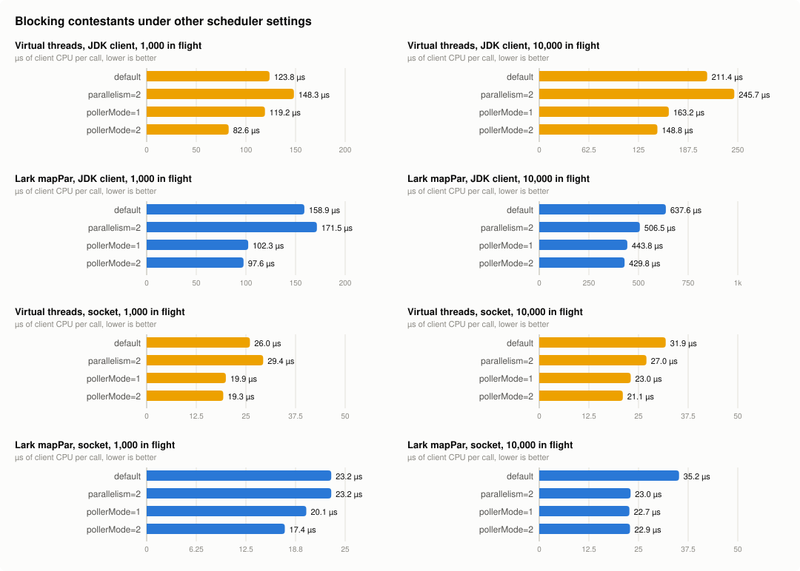

# Draft: real network I/O

A draft section for the README, to fold in. Numbers are from `results/net.txt`, through `scripts/summarise.py`.

## Real sockets


On the shared device, the blocking contestants used 2.5–4× Reactor's CPU per call, and a profile blamed the
wake-up: every call's future was completed on a platform timer thread, which then had to unpark a virtual thread. This
test asks whether that gap survives real sockets.

**On blocking sockets, it doesn't: the gap reverses.** Virtual threads blocked in a plain `Socket` read are woken by
the JDK's own poller, and they use 0.6–0.7× the CPU per call of Reactor Netty, Reactor at its best.

**But it comes back when the "blocking" call goes through the JDK's `HttpClient`.** That client is asynchronous inside
(`send` is `sendAsync(...).get()`), so a virtual thread in `send` is still woken by a platform thread, as on the fake
device. Blocking code on it uses 2.4–3.4× Reactor Netty's CPU per call. Reactor on the same client costs as much, so
most of that gap belongs to the client, not to blocking.

### The test

Each call is an HTTP/1.1 `GET` over loopback, with keep-alive, to a server in its own JVM that answers after 10 ms.
The server is Netty on one event-loop thread, which holds each answer on its timer, so no thread waits per request.
It runs pinned to core 3 with `taskset`, and the client to cores 0–2, so the client's process CPU is the client's
alone. Each fork starts a fresh server. Code: [`NetServer.kt`](../src/main/kotlin/bvr/NetServer.kt),
[`NetScenario.kt`](../src/main/kotlin/bvr/NetScenario.kt), and [`run-net.sh`](../scripts/run-net.sh).

| contestant | what it is |
|---|---|
| `vt-plain` | JDK `HttpClient.send` on a virtual thread per call, bounded by a `Semaphore` |
| `lark` | `mapPar(n) { client.send(...) }` |
| `lark-async` | `mapAsync(n) { client.sendAsync(...) }` |
| `reactor-netty` | Reactor Netty's `HttpClient` under `flatMap(..., n)`, with its pool sized to n |
| `reactor-jdk` | `Flux.flatMap({ Mono.fromFuture(client.sendAsync(...)) }, n)` |
| `pekko` | `mapAsyncUnordered(n) { client.sendAsync(...) }` |
| `vt-socket` | as `vt-plain`, but over a plain `java.net.Socket` with a small hand-written HTTP/1.1 client and a pool of keep-alive connections |
| `lark-socket` | `mapPar(n)` over the same socket client |

Every JDK-client contestant shares one `HttpClient` with its default executor. It's an HTTP/1.1 client, and its
keep-alive timeout is raised so that no connection closes between iterations. The JDK never caps how many HTTP/1.1
connections it opens; its only limit, `jdk.httpclient.connectionPoolSize`, counts idle connections, and is unbounded
by default. The two `-socket` contestants were added because the JDK client never parks a virtual thread on the
poller, so without them this test couldn't answer its own question.

Medians over 2 JVM forks × 4 measured iterations, after 2 warm-up iterations. Every contestant held its *n* calls in
flight (the max-outstanding column).

### Results

CPU per call is µs of client process CPU; "server" is the server's mean CPU over the fork, on its one core.

| contestant | 16: ops/s | 16: CPU µs | 1k: ops/s | 1k: CPU µs | 10k: ops/s | 10k: CPU µs | alloc B/op (1k) |
|---|--:|--:|--:|--:|--:|--:|--:|
| `vt-socket` | 1,480 | 86 | 68,290 | 28.5 | 72,170 | 26.6 | 1,854 |
| `lark-socket` | 1,474 | 93 | 69,564 | 26.5 | 66,210 | 26.7 | 2,050 |
| `reactor-netty` | 1,494 | 148 | 43,723 | 41.7 | 53,994 | 42.9 | 8,408 |
| `vt-plain` (JDK client) | 1,421 | 374 | 20,541 | 118 | 10,512 | 209 | 15,207 |
| `lark` (JDK client) | 1,380 | 356 | 17,846 | 140 | 2,685 | 610 | 15,732 |
| `lark-async` (JDK client) | 1,374 | 356 | 15,949 | 160 | 1,686 | 1,146 | 14,662 |
| `reactor-jdk` (JDK client) | 1,433 | 336 | 17,674 | 143 | 4,509 | 542 | 15,176 |
| `pekko` (JDK client) | 1,420 | 416 | 17,886 | 142 | 4,600 | 522 | 14,630 |

The ceiling is 1,600 ops/s at 16 in flight, 100k at 1k and 1M at 10k, but the one-core server tops out at about
70k answers a second. The socket contestants reach it (server CPU 88–91%), so their throughput at 1k and 10k is the
server's, not theirs. Every other contestant leaves the server idle for part of the run.

CPU per call, against Reactor Netty, and against the shared device's gap:

| | 16 | 1k | 10k |
|---|--:|--:|--:|
| blocking sockets (`vt-socket`, `lark-socket`) ÷ Reactor Netty | 0.58–0.63× | 0.64–0.68× | 0.62× |
| blocking on the JDK client (`vt-plain`, `lark`) ÷ Reactor Netty | 2.4–2.5× | 2.8–3.4× | 4.9–14× |
| blocking on the JDK client ÷ Reactor on the JDK client | 1.06–1.11× | 0.83–0.97× | 0.39–1.13× |
| shared device, for comparison: `vt-plain`, `lark` ÷ Reactor | – | 1.7–2.1× | 3.8–4.7× |

### What it shows

- **The 2.5–4× gap was mostly the wake-up path, not blocking.** Over sockets, the same `Semaphore` loop and the same
  `mapPar` use about two-thirds of Reactor Netty's CPU per call, allocate a quarter as much, and need a third of the
  RSS. Part of that edge is that the hand-written socket client does less than Reactor Netty's full HTTP codec, so
  read it as "blocking sockets are not more expensive", not as a margin to bank.
- **The JDK `HttpClient` is the expensive part on the JVM side.** Every contestant that uses it, blocking or async,
  costs 118–160 µs per call at 1k against Reactor Netty's 42. Blocking on it costs about what Reactor costs on it.
- **The JDK `HttpClient` collapses at 10,000 connections.** Throughput falls to 1.7–10k ops/s and CPU per call rises
  to 0.2–1.1 ms. Two causes, both in the JDK's code, and neither about virtual threads:
  - its connection pool checks out and returns each connection by walking a `LinkedList` of every idle connection,
    under one lock (`ConnectionPool.findConnection` → `ExpiryList.remove`, and `ExpiryList.add`, whose deadlines are
    cut to whole seconds, so a return walks the whole list);
  - its default executor is an unbounded cached pool, which grew to about 8,800 platform threads, most of them waiting
    on that lock.

  `vt-plain` suffers least (10.5k ops/s against 1.7–4.6k for the others); I haven't profiled why.
- **Lark's `mapAsync` loses here.** On the JDK client it is the slowest at 1k and 10k. It still holds a pending call
  without a parked thread, but that doesn't help when the client spends 1 ms of CPU per call.

### Scheduler settings



The blocking contestants again, at 1k and 10k, with `-Djdk.virtualThreadScheduler.parallelism=2` (the default is the
client's 3 cores), and with each value of `-Djdk.pollerMode` that JDK 25 accepts. Per `sun/nio/ch/Poller.java` there
are two:
- `1`, or `SYSTEM_THREADS`: platform `Read-Poller` and `Write-Poller` threads unpark the virtual threads;
- `2`, or `VTHREAD_POLLERS`: the pollers are virtual threads under a platform `MasterPoller`. This is Linux's default.

Any other value throws, which I checked by running it. `2` is the default, so its column shows the run-to-run noise:
up to 8%.

CPU µs per call (ops/s):

| scenario | contestant | default | parallelism=2 | pollerMode=1 | pollerMode=2 |
|---|---|--:|--:|--:|--:|
| 1k | `vt-plain` (JDK client) | 118.4 (20,541) | 119.6 (20,362) | 120.1 (20,446) | 124.0 (19,756) |
| 1k | `lark` (JDK client) | 139.6 (17,846) | 140.8 (17,769) | 140.2 (17,835) | 137.6 (18,161) |
| 1k | `vt-socket` | 28.5 (68,290) | 26.0 (68,992) | 29.9 (62,384) | 27.7 (70,134) |
| 1k | `lark-socket` | 26.5 (69,564) | 22.2 (68,846) | 28.7 (57,138) | 26.7 (69,568) |
| 10k | `vt-plain` (JDK client) | 208.9 (10,512) | 193.9 (11,510) | 211.6 (10,484) | 197.4 (11,212) |
| 10k | `lark` (JDK client) | 609.6 (2,685) | 566.7 (2,890) | 589.4 (2,767) | 614.9 (2,760) |
| 10k | `vt-socket` | 26.6 (72,170) | 28.8 (69,792) | 30.3 (63,674) | 27.2 (68,162) |
| 10k | `lark-socket` | 26.7 (66,210) | 25.0 (63,084) | 31.7 (53,688) | 28.8 (63,012) |

- **On the JDK client, neither setting matters.** Every change is within the noise. Its virtual threads are never
  parked on the poller, so the poller mode can't touch them.
- **On sockets, the platform-thread pollers (`pollerMode=1`) cost more.** They use 5–19% more CPU per call, and do
  9–19% fewer calls a second, even though the socket contestants are held back by the server.
- **`parallelism=2` is no worse, and perhaps slightly better, on sockets at 1k:** 9–16% less CPU per call, at the edge
  of the noise. At 10k it is within the noise.

### Caveats

- One 4-core cloud VM, loopback only: no real network latency, loss or bandwidth. The client had 3 cores and the
  server 1.
- The socket client is about 40 lines, written for this test: HTTP/1.1, `content-length` only, no timeouts, TLS or
  redirects.
- The server's listen backlog: the kernel caps one at `net.core.somaxconn` (4,096 here), and 10,000 clients
  connecting at once overflowed it, which left handshakes waiting out TCP's retransmit back-off. The server now binds
  four listeners to the port with `SO_REUSEPORT`, and the kernel's overflow counters stayed flat afterwards.
- At 10k, a run is 100,000 calls, only ten windows long, because the JDK-client contestants take about a minute per
  iteration.
- Versions: as above, plus reactor-netty-http 1.3.7 (Netty 4.2.17).

### Running it

```bash
scripts/run-net.sh                 # results/net.txt; about 3 hours, most of it the JDK client at 10k
python3 scripts/summarise.py > results/summary.md
python3 scripts/charts.py          # adds docs/charts/net.svg and net-scheduler.svg
```
